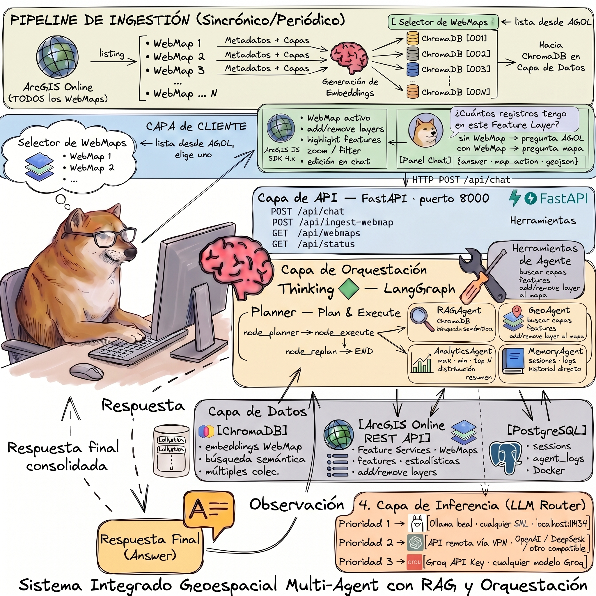
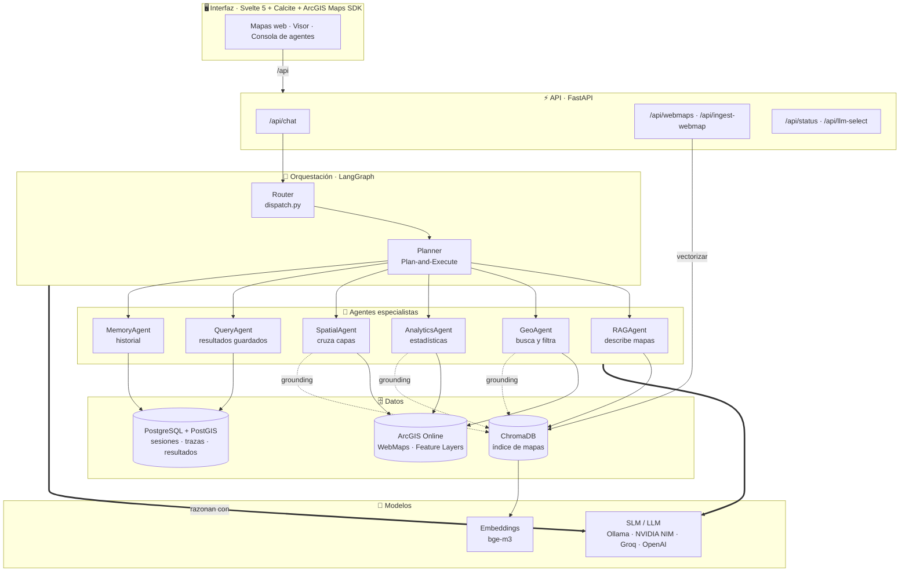
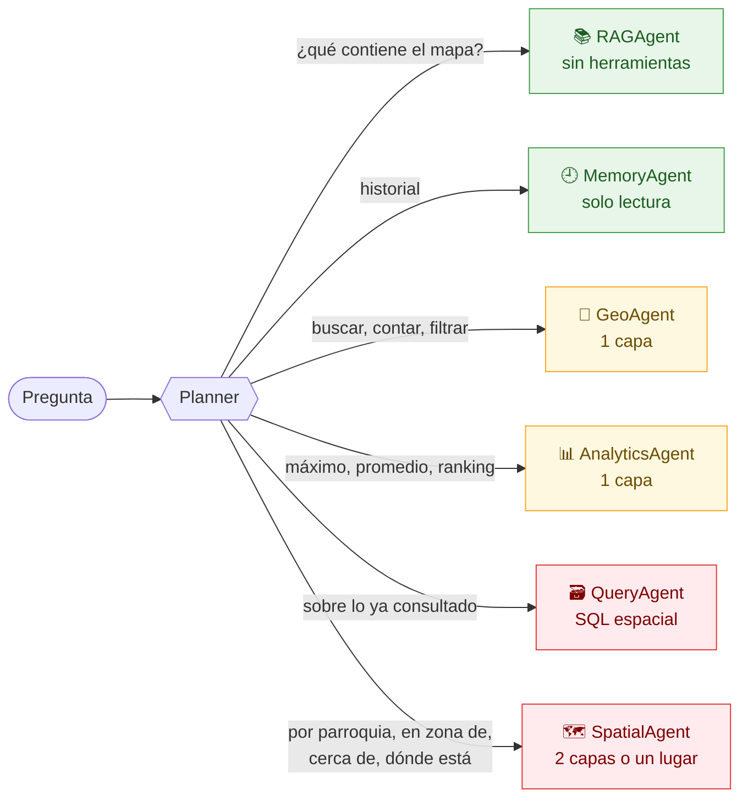
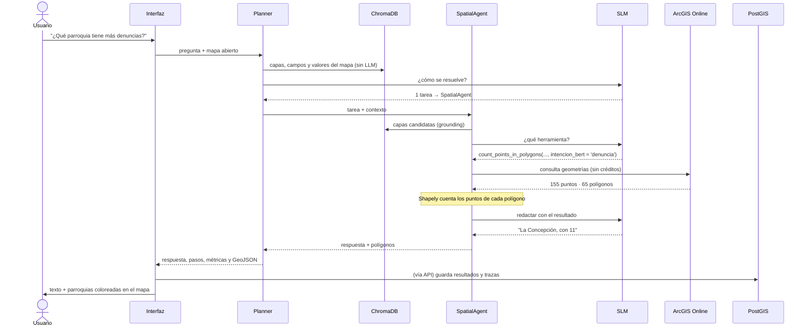
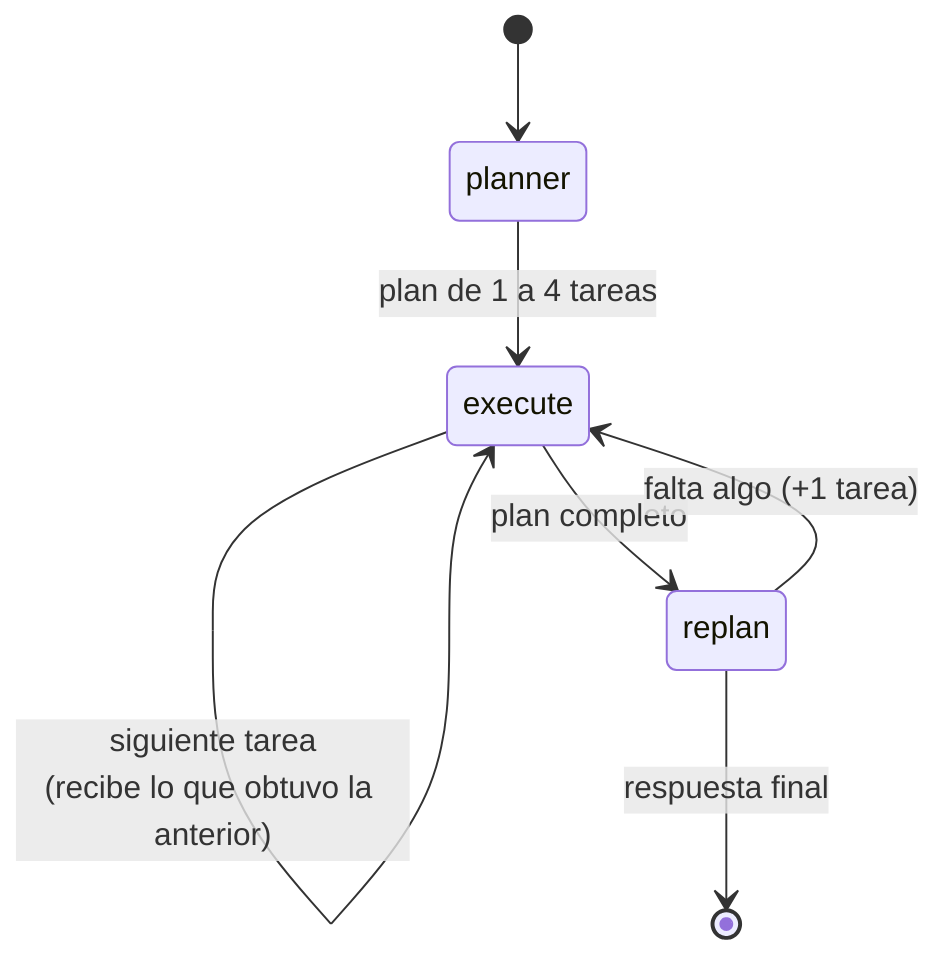
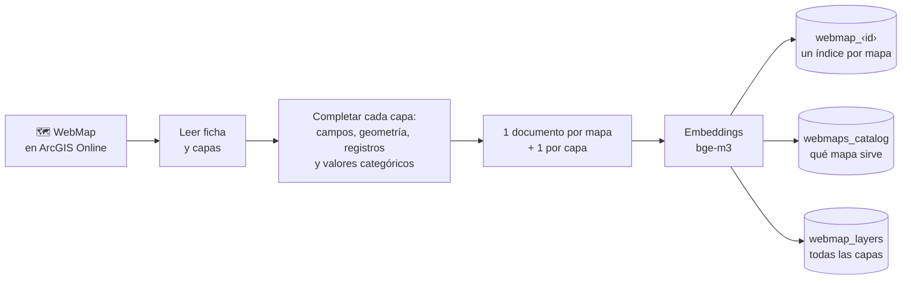

<p align="center">
     
</p>

# Sistema Multi-Agente Geoespacial

**Arquitectura multi-agente geoespacial: planificación jerárquica con Small Language Models (SLMs) para la automatización de análisis espacial en ArcGIS**

Universidad San Francisco de Quito · Colegio de Posgrados · Maestría en Ciencia de Datos


---

## De qué trata

En una organización con ArcGIS Online, los datos ya están ahí: reportes ciudadanos, accidentes de tránsito, zonas de amenaza volcánica, áreas protegidas. Lo que cuesta es **preguntarles algo**. Saber qué parroquia concentra más denuncias o qué parte de una parroquia está expuesta a un volcán exige abrir ArcGIS Pro, elegir una herramienta de geoprocesamiento, configurarla y leer el resultado.

GeoAgent permite hacer esa pregunta en español, tal cual se diría en voz alta, y recibir la respuesta con el resultado dibujado en el mapa:

```
"¿Qué parroquia tiene más denuncias ciudadanas?"

  Planner       → es un cruce de dos capas → SpatialAgent
  SpatialAgent  → count_points_in_polygons(reportes, parroquias, intencion_bert = 'denuncia')
  Respuesta     → La Concepción, con 11 de las 155 denuncias
  Mapa          → las parroquias coloreadas por número de denuncias
```

Detrás hay un **Planner** que entiende la pregunta y la reparte entre **seis agentes especializados**, cada uno con sus propias herramientas. La idea central de la tesis es que todo esto lo puede razonar un **modelo pequeño que corre en una laptop** (Qwen 2.5 de 7B parámetros, en Ollama) y no solo un modelo grande en la nube. Para comprobarlo, el mismo sistema se evalúa con varios modelos sobre las mismas preguntas.

El sistema se apoya en otro proyecto: el campo `intencion_bert` de los reportes ciudadanos (queja, denuncia, solicitud, consulta, sugerencia, agradecimiento) lo genera el clasificador de intención con BERT del proyecto `clasificador-intencion-dmq`, que se entrenó aparte y se desplegó como paquete `.dlpk` de ArcGIS.

## Contenido

1. [Inicio rápido](#1-inicio-rápido)
2. [Arquitectura](#2-arquitectura)
3. [El Planner](#3-el-planner)
4. [Los seis agentes](#4-los-seis-agentes)
5. [Herramientas](#5-herramientas)
6. [Vectorización y grounding](#6-vectorización-y-grounding)
7. [Diseñado para modelos pequeños](#7-diseñado-para-modelos-pequeños)
8. [Modelos](#8-modelos)
9. [Evaluación](#9-evaluación)
10. [Interfaz](#10-interfaz)
11. [API](#11-api)
12. [Configuración](#12-configuración)
13. [Tests](#13-tests)
14. [Estructura del proyecto](#14-estructura-del-proyecto)
15. [Seguridad](#15-seguridad)
16. [Limitaciones y trabajo futuro](#16-limitaciones-y-trabajo-futuro)
17. [Problemas frecuentes](#17-problemas-frecuentes)

---

## 1. Inicio rápido

Necesitas **Docker Desktop**, **[Ollama](https://ollama.com/download)** y una **cuenta nativa de ArcGIS Online** (las cuentas con inicio de sesión institucional o MFA no funcionan; ver [limitaciones](#16-limitaciones-y-trabajo-futuro)).

```bash
# 1. Modelos locales
ollama pull bge-m3        # embeddings para el índice de mapas
ollama pull qwen2.5:7b    # el SLM que razona

# 2. Credenciales
cp .env.example .env      # completa ARCGIS_USERNAME y ARCGIS_PASSWORD
                          # (y NVIDIA_NIM_API_KEY si quieres comparar con gpt-oss-20b)

# 3. Levantar todo
docker compose up -d --build
```

| Servicio | Dirección |
|---|---|
| Interfaz | http://localhost:5173 |
| API y documentación interactiva | http://localhost:8000/docs |
| ChromaDB | http://localhost:8001 |
| PostgreSQL / PostGIS | `localhost:5432` |

Abre la interfaz, **vectoriza** tus mapas (el ícono a la derecha de cada uno), elige uno y pregunta. El modelo se cambia desde la barra superior.

---

## 2. Arquitectura

### Vista general

El sistema está en capas y cada una solo conoce a la de abajo. La interfaz habla con la API, la API entrega la pregunta al Planner, el Planner reparte el trabajo entre los agentes y los agentes consultan los datos.



| Capa | Qué hace | Tecnología |
|---|---|---|
| **Interfaz** | Elegir y vectorizar mapas, preguntar, ver la respuesta y el resultado sobre el mapa | Svelte 5, Calcite 3.3, ArcGIS Maps SDK 4.34, servido con Bun |
| **API** | Exponer el sistema por HTTP sin bloquearse mientras un agente trabaja | FastAPI + Uvicorn |
| **Orquestación** | Decidir qué agente resuelve cada parte de la pregunta y en qué orden | LangGraph |
| **Agentes** | Resolver un tipo de tarea con un conjunto acotado de herramientas | LangChain con *tool calling* nativo |
| **Datos** | La fuente de verdad (ArcGIS Online), el índice semántico (Chroma) y la memoria (PostGIS) | ArcGIS API for Python, Shapely, ChromaDB, PostgreSQL 16 + PostGIS |
| **Modelos** | Razonar y convertir texto en vectores | Ollama, NVIDIA NIM, Groq, OpenAI o cualquier endpoint compatible |

Todo corre en contenedores: `postgres`, `chroma`, `api` y `frontend`. El contenedor de la API usa el Ollama instalado en tu PC (`host.docker.internal:11434`), así el modelo aprovecha tu GPU.

### Qué agente hace qué

Los agentes no le exigen lo mismo al modelo. Los de la izquierda casi no le piden nada; el SpatialAgent es la prueba más dura para un SLM, porque tiene que coordinar dos capas, elegir el filtro correcto y a veces encadenar pasos.



<sub>Verde: exigencia baja para el modelo · Amarillo: media · Rojo: alta</sub>

### Recorrido de una pregunta espacial



---

## 3. El Planner

El Planner sigue el patrón **Plan-and-Execute**: primero piensa el plan completo y después lo ejecuta paso a paso. Es la "planificación jerárquica" del título: un nivel decide *qué* hay que hacer y otro nivel, el de los agentes, decide *cómo*.



| Nodo | Qué hace | Llamadas al modelo |
|---|---|---|
| **planner** | Lee la pregunta y, si hay un mapa abierto, sus capas, campos y valores. Devuelve de 1 a 4 tareas, cada una con su agente, en **JSON validado** (esquema Pydantic) | 1 |
| **execute** | Ejecuta la tarea con su agente y le pasa lo que obtuvieron los pasos anteriores | las del agente |
| **replan** | Decide si ya se puede responder o si falta una tarea. **Se omite si el plan tenía una sola tarea y salió bien**: la respuesta del agente ya es la final | 0 o 1 |

El prompt del Planner incluye ejemplos con **capas ficticias** (Incidentes, Barrios, Hospitales). Así aprende el patrón sin que se le "sople" la respuesta de las preguntas de evaluación, que usan las capas reales.

Para mandar una pregunta directo a un agente, sin pasar por el Planner, se usa un prefijo:

| Prefijo | Agente |
|---|---|
| `spatial:` | SpatialAgent |
| `analytics:` o `query:` | AnalyticsAgent |
| `geo:` | GeoAgent |
| `postgis:` | QueryAgent |
| `rag:` | RAGAgent |
| `plan:` o **sin prefijo** | Planner |

`dispatch()` es la única puerta de entrada al sistema: la usan la API, la consola (`main.py`) y la evaluación. Así las tres miden exactamente lo mismo.

---

## 4. Los seis agentes

Todos comparten la misma base (`agents/base.py`): un bucle en el que el modelo elige una herramienta, ve el resultado y decide si sigue o responde. Antes de empezar, cada agente recibe las **capas candidatas** del índice con su URL, sus campos y los valores de sus campos categóricos, para que no tenga que adivinarlos.

**RAGAgent: describe los mapas.** Responde de qué trata un mapa, qué capas tiene y qué campos tienen esas capas. No va a ArcGIS ni usa herramientas: busca en el índice vectorial y redacta en una sola llamada. *"¿Qué capas tiene el mapa de Riesgos?"* → Amenaza Volcánica y Parroquias DMQ.

**GeoAgent: busca y filtra.** Trabaja directo con ArcGIS Online. Encuentra capas en la organización, revisa sus campos y trae registros con filtros. *"¿Cuántos reportes de gravedad alta hay?"* → 479.

**AnalyticsAgent: estadísticas de una capa.** Máximos, promedios, rankings y distribuciones dentro de una sola capa. **Los cálculos los hace el servidor de ArcGIS** y el modelo solo elige capa, campo y operación, porque la aritmética es justo donde un modelo pequeño se equivoca. *"¿Cuál es la intención más frecuente en los reportes?"* → queja.

**SpatialAgent: cruza capas por su ubicación.** Es el análisis espacial propiamente dicho. Cuenta cuántos puntos caen en cada polígono, superpone polígonos, mide cercanía entre capas y ubica lugares por su nombre. Descarga las geometrías desde ArcGIS sin gastar créditos y calcula con Shapely. *"¿Qué parroquia es la más expuesta a las amenazas del Pichincha?"* → Lloa, con el 55 % de su territorio.

**QueryAgent: trabaja sobre lo ya consultado.** Cada vez que un agente trae registros, el sistema los guarda en PostGIS. Este agente los vuelve a consultar con operaciones espaciales o SQL de solo lectura, sin pedirlos otra vez a ArcGIS.

**MemoryAgent: el historial.** Consulta qué se preguntó antes y qué respondió el sistema. Solo lee: guardar lo hace el código, para que no sea el modelo el que decida qué se recuerda.

| Agente | Herramientas | Datos |
|---|---|---|
| RAGAgent | — (búsqueda semántica) | ChromaDB |
| GeoAgent | `search_layers`, `get_layer_info`, `count_features`, `query_features`, `query_features_near` | ArcGIS Online |
| AnalyticsAgent | `field_statistics`, `top_n_features`, `count_by_category`, `layer_summary` | ArcGIS Online |
| SpatialAgent | `count_points_in_polygons`, `overlay_polygons`, `count_points_near`, `nearest_features`, `locate_point`, `geocode_place` | ArcGIS Online + Shapely |
| QueryAgent | `query_geo_results`, `spatial_buffer`, `find_nearest`, `count_by_layer`, `run_sql_spatial` | PostGIS |
| MemoryAgent | `get_recent_sessions`, `search_sessions`, `get_session_logs` | PostGIS |

---

## 5. Herramientas

Todas tienen **argumentos tipados** y son **de solo lectura**: ningún agente modifica nada en ArcGIS Online.

### Análisis espacial entre capas (`tools/spatial_tools.py`)

| Herramienta | Responde preguntas como | Devuelve |
|---|---|---|
| `count_points_in_polygons` | ¿Qué parroquia tiene más denuncias? ¿Qué predomina en Quitumbe? | Ranking de polígonos por cantidad de puntos, con desglose opcional por categoría |
| `overlay_polygons` | ¿Qué parroquias están en zona de amenaza? ¿En qué provincia está la mayor parte del Cotopaxi? | Polígonos afectados con área, % de su territorio cubierto y % de la otra capa que contienen |
| `count_points_near` | ¿Cuántos reportes de seguridad hay a menos de 500 m de un accidente? | Puntos dentro de la distancia y su porcentaje |
| `nearest_features` | ¿Qué área protegida está más cerca de Quito? ¿Cuáles hay a menos de 50 km? | Los más cercanos, o todos dentro de un radio, con su distancia |
| `locate_point` | ¿En qué parroquia está el parque La Carolina? | El polígono que contiene el punto, o el más cercano |
| `geocode_place` | (paso previo de las dos anteriores) | Coordenadas de un lugar de Ecuador |

**¿Por qué calcular aquí y no con los servicios de análisis de ArcGIS?** Herramientas como *Aggregate Points* u *Overlay Layers* de ArcGIS Online consumen créditos y tardan minutos. Una consulta que devuelve geometrías no consume créditos, y la geocodificación sin guardar el resultado (`for_storage=False`) tampoco. Así que se descargan las features, Shapely hace el cálculo con un índice espacial (`STRtree`) y el modelo recibe solo el resultado. Las capas descargadas se reutilizan durante 5 minutos.

**¿Y las distancias?** Se usa una proyección equirectangular local centrada en los datos. En Ecuador, sobre la línea equinoccial, el error es menor al 0,5 %.

### Una sola capa (`tools/arcgis_tools.py`, `tools/analytics_tools.py`)

| Herramienta | Devuelve |
|---|---|
| `search_layers` | Capas de la organización que coinciden con una palabra |
| `get_layer_info` | Geometría, número de registros, campos y valores de los campos categóricos |
| `count_features` | Cuántos registros cumplen un filtro |
| `query_features` | Registros que cumplen un filtro (se dibujan en el mapa) |
| `query_features_near` | Registros a menos de N metros de un punto |
| `field_statistics` | Mínimo, máximo, promedio, suma y conteo de un campo numérico |
| `top_n_features` | Los N registros con mayor o menor valor |
| `count_by_category` | Cuántos registros hay de cada valor de un campo |
| `layer_summary` | Resumen general de la capa |

---

## 6. Vectorización y grounding

**Vectorizar** un mapa es convertir su descripción (ficha, capas, campos y valores) en textos cortos, calcular su embedding con `bge-m3` y guardarlos en ChromaDB, para poder buscarlos por significado.



Los **valores de los campos categóricos** (por ejemplo `intencion_bert = queja|denuncia|…` o `categoria = basura|seguridad|…`) resultaron clave. Sin ellos, ante *"¿qué parroquia tiene más denuncias?"*, los modelos contaban **todos** los reportes, porque no sabían que "denuncias" se traduce en `intencion_bert = 'denuncia'`.

El **grounding** es lo que conecta el índice con los agentes: antes de cada tarea, el sistema busca las capas más parecidas a la pregunta y se las entrega al agente con su URL, campos y valores. El modelo elige de una lista corta en vez de inventar.

Hay que **volver a vectorizar** cuando cambia el mapa en ArcGIS Online o el modelo de embeddings. Si cambias de modelo de embeddings sin hacerlo, el sistema avisa en lugar de devolver resultados sin sentido.

---

## 7. Diseñado para modelos pequeños

Un modelo de 7B falla sobre todo en tres cosas: **escribir formatos libres**, **elegir entre muchas opciones** y **mantener contextos largos**. Cada decisión de diseño le quita una de esas cargas.

| Lo que suele fallar en un SLM | Cómo lo resuelve el sistema |
|---|---|
| Romper el formato de texto de ReAct | *Tool calling* nativo: la llamada llega como estructura, no como texto a interpretar |
| Escribir JSON inválido | Argumentos tipados y salida estructurada validada con Pydantic |
| Inventar URLs y nombres de campo | Grounding con capas, campos y valores reales |
| Equivocarse en un nombre de campo | Se aceptan alias; si el campo no existe, el error trae los parecidos para que se corrija |
| Hacer mal las cuentas | Los cálculos los hacen ArcGIS o Shapely, nunca el modelo |
| Quedarse sin contexto | Las geometrías viajan por un canal lateral al mapa; el modelo solo ve resúmenes |
| Escribir el nombre de un agente a su manera ("spatial", "Geo Agent") | Se normaliza antes de validar el plan |
| Escribir SQL para filtrar por nombre | `polygon_name="la concepcion"` encuentra `LA CONCEPCIÓN` sin SQL |
| Rendirse cuando un filtro no devuelve nada | La herramienta muestra los valores reales del campo para que corrija |
| Cada llamada extra multiplica el riesgo de error | Sin replan si basta una tarea; el RAG responde en una sola llamada |

### Lo que se aprendió de las trazas

Buena parte de estas decisiones no se diseñaron de antemano: salieron de mirar, pregunta por pregunta, qué hacía cada modelo. La evaluación guarda una **traza completa** (plan, cada herramienta con sus argumentos y su salida, y la respuesta final), y revisarla separó dos tipos de fallo muy distintos:

- **Fallos del sistema**, que se corrigieron. Por ejemplo: un filtro de texto perdía su comilla final y ArcGIS lo rechazaba; los modelos no veían los valores de los campos; la lista de ~200 campos de la capa de accidentes ocupaba casi la mitad del contexto de un SLM.
- **Fallos del modelo**, que se dejaron tal cual porque son justamente lo que la tesis mide. Por ejemplo: Qwen interpreta "reportes de seguridad" como quejas, aunque tiene a la vista el valor `seguridad` del campo `categoria`.

Ese ciclo de evaluar, revisar las trazas, corregir solo lo que es del sistema y volver a evaluar es parte de la metodología: garantiza que el resultado final mide la capacidad de cada modelo y no errores de implementación.

---

## 8. Modelos

El modelo se elige con el formato `proveedor/modelo`, desde la barra superior de la interfaz (dura mientras la API esté encendida) o con `LLM_MODEL` en el `.env` (el modelo con el que arranca). El selector muestra automáticamente los modelos instalados en Ollama.

| Modelo | Tipo | Papel en la tesis |
|---|---|---|
| `ollama/qwen2.5:7b` | SLM local | Modelo pequeño principal |
| `ollama/mistral:7b` | SLM local | Segundo SLM de otra familia |
| `ollama/llama3.1:8b` | SLM local | Alternativa de otra familia |
| `nvidia_nim/openai/gpt-oss-20b` | LLM por API | Referencia de modelo grande |
| `groq/…`, `openai/…`, `vpn/…` | LLM por API | Disponibles si tienes la clave |

El modelo tiene que soportar *tool calling* (en Ollama, los que muestran la etiqueta `tools`). Aun así, soportarlo no garantiza usarlo bien: para comprobarlo existe `eval/diagnostico_tools.py` (ver [evaluación](#9-evaluación)).

Los **embeddings** son independientes del modelo que razona: siempre `bge-m3` en Ollama, multilingüe y fijo entre corridas. Así la comparación entre modelos se hace con exactamente la misma búsqueda.

---

## 9. Evaluación

`eval/run_eval.py` pasa el mismo set de preguntas por el sistema completo con cada modelo y mide:

| Métrica | Qué mide |
|---|---|
| Acierto de respuesta | La respuesta contiene el valor correcto |
| Acierto de herramienta | Se llamaron las herramientas esperadas |
| Acierto de agente | El Planner eligió el agente correcto |
| Tasa de error | Fallas del sistema: excepciones, formato, tiempo agotado |
| Latencia | Tiempo medio y mediana por pregunta |
| Costo | Llamadas al modelo y tokens de entrada y salida |

**La respuesta correcta no se escribe a mano: se calcula en vivo** llamando a la misma herramienta con los argumentos correctos. Así siempre coincide con los datos actuales de ArcGIS Online.

### El set de preguntas (`eval/preguntas_tesis.json`)

40 preguntas sobre los cuatro mapas de la organización:

| Mapa | Capas | Preguntas | Ejemplo |
|---|---|---|---|
| Reportes Ciudadanos | Reportes (con `intencion_bert`) · Parroquias DMQ | 11 | ¿Qué parroquia tiene más denuncias ciudadanas? |
| Accidentes de tránsito DMQ | Accidentes · Parroquias DMQ | 10 | ¿Qué parroquia tiene más accidentes con fallecidos? |
| Riesgos | Amenaza Volcánica · Parroquias DMQ | 8 | ¿Qué parroquia es la más expuesta al Pichincha? |
| Parques Nacionales Ecuador | Áreas protegidas (SNAP) · Provincias | 9 | ¿Qué área protegida está más cerca de Quito? |
| Entre mapas | Reportes · Accidentes | 2 | ¿Cuántos reportes de seguridad hay a menos de 500 m de un accidente? |

26 son **espaciales** y las resuelve el SpatialAgent. Las otras 14 (conteo, distribución, estadística, ranking y descripción del mapa) son el **grupo de control** de una sola capa. Comparar ambos grupos muestra cuánto le cuesta a cada modelo pasar de consultar una capa a razonar sobre dos.

### Cómo correrla

```bash
# 1. Ver la respuesta correcta de cada pregunta (sin modelo)
docker compose exec api python eval/run_eval.py --referencias

# 2. ¿Cada modelo hace tool calling a través del sistema?
docker compose exec api python eval/diagnostico_tools.py \
  --modelos ollama/qwen2.5:7b,ollama/mistral:7b

# 3. Evaluación completa
docker compose exec api python eval/run_eval.py \
  --modelos ollama/qwen2.5:7b,ollama/mistral:7b,nvidia_nim/openai/gpt-oss-20b \
  --repeticiones 3

# 4. Sacar los resultados del contenedor
docker cp geo_agents_api:/app/eval/resultados ./eval/resultados
```

Cada corrida deja en `eval/resultados/<fecha>/`:

| Archivo | Contenido |
|---|---|
| `resumen.md` · `resumen.csv` | Métricas por modelo y acierto por categoría |
| `detalle.csv` | Una fila por pregunta, modelo y repetición |
| `trazas.jsonl` | Plan, herramientas con argumentos y salidas, y respuesta: para entender **por qué** falló una pregunta |

El **diagnóstico de tool calling** prueba cada modelo con una herramienta trivial en inglés, la misma en español y el prompt real del SpatialAgent. Distingue un problema de integración (no llama ni en el caso trivial) de una limitación del modelo (llama en el caso trivial pero no con el prompt real). Por ejemplo, Mistral 7B pasa los casos triviales pero, ante el prompt del SpatialAgent, describe la llamada en texto en vez de ejecutarla.

**Buenas prácticas:** embeddings fijos (`EMBEDDING_PROVIDER=ollama`), `LLM_TEMPERATURE=0` y al menos 3 repeticiones.

---

## 10. Interfaz

La interfaz está pensada para que **el mapa sea el protagonista**. La lista de mapas (izquierda) y la consola de agentes (derecha) se pliegan desde su barra de iconos y el navegador recuerda cómo las dejaste. Si llega una respuesta con la consola plegada, aparece un aviso en su ícono, y el resultado igual se dibuja en el mapa.

En la consola, cada respuesta muestra qué agente la resolvió, qué herramientas usó (desplegables), las capas citadas y las métricas: llamadas al modelo, tokens y tiempo.

| Archivo | Qué hace |
|---|---|
| `src/App.svelte` | Armazón: barra superior, lista de mapas, visor y consola, con paneles plegables |
| `components/InstrumentStrip.svelte` | Barra superior: modelo activo y su selector, estado de ArcGIS, PostGIS y el índice, modo claro u oscuro |
| `components/WebMapPicker.svelte` | Lista de mapas web y botón para vectorizarlos |
| `components/MapPanel.svelte` | Visor: abre el mapa y dibuja los resultados |
| `components/ChatPanel.svelte` | Consola: preguntas, respuestas, pasos y métricas |
| `lib/markdown.ts` | Formato de las respuestas; escapa todo el HTML antes de formatear |
| `server.ts` | Servidor de producción en Bun y proxy de `/api` |

La versión de Calcite (`index.html`) debe coincidir con la del SDK de mapas, según la [matriz de versiones de Esri](https://developers.arcgis.com/javascript/latest/version-matrix/): SDK 4.34 ↔ Calcite 3.3.2.

---

## 11. API

Documentación interactiva en http://localhost:8000/docs.

| Método | Ruta | Para qué |
|---|---|---|
| `POST` | `/api/chat` | Preguntar: `{"message": "...", "webmap_id": "..."}` |
| `GET` | `/api/webmaps` · `/api/webmaps/{id}` | Mapas de la cuenta y detalle de uno |
| `POST` | `/api/ingest-webmap` | Vectorizar un mapa (o todos, sin `webmap_id`) |
| `DELETE` | `/api/webmaps/{id}/index` | Borrar el índice de un mapa |
| `POST` | `/api/webmaps/search` | Búsqueda semántica directa, útil para revisar el índice |
| `GET` | `/api/status` · `/api/vector-status` | Estado del sistema y del índice |
| `GET` | `/api/ollama-models` | Modelos instalados en Ollama |
| `POST` | `/api/llm-select` | Cambiar de modelo en caliente |
| `GET` | `/api/sessions` | Historial |

La respuesta de `/api/chat` trae el texto, el agente, el plan, los pasos con sus herramientas, las capas citadas, el **GeoJSON** para el mapa y las métricas.

---

## 12. Configuración

Todas las variables están comentadas en [`.env.example`](.env.example). Las que más importan:

| Variable | Por defecto | Para qué |
|---|---|---|
| `LLM_MODEL` | `nvidia_nim/openai/gpt-oss-20b` | Modelo con el que arranca la API |
| `LLM_TEMPERATURE` | `0` | Respuestas reproducibles |
| `OLLAMA_DOCKER_URL` | `http://host.docker.internal:11434` | Dónde encuentra el contenedor a tu Ollama |
| `OLLAMA_NUM_CTX` | `8192` | Ventana de contexto. Sin fijarla, Ollama recorta el prompt en silencio |
| `OLLAMA_EMBED_MODEL` · `EMBEDDING_PROVIDER` | `bge-m3` · `ollama` | Embeddings del índice |
| `GROUNDING_K` · `GROUNDING_MIN_SIM` | `4` · `0.25` | Cuántas capas candidatas recibe cada agente |
| `AGENT_MAX_ITERATIONS` | `6` | Máximo de herramientas por agente |
| `WEBMAPS_EXCLUDE_TAGS` | `Survey123` | Mapas que no se listan (Survey123 crea uno con cada formulario) |
| `ARCGIS_USERNAME` · `ARCGIS_PASSWORD` | — | Cuenta de ArcGIS Online |
| `NVIDIA_NIM_API_KEY` | — | Solo para el modelo de referencia por API |

> `docker compose restart` **no** vuelve a leer el `.env`. Después de editarlo usa `docker compose up -d api`.

---

## 13. Tests

```bash
make test        # o: pytest tests/test_offline.py tests/test_spatial.py -v
```

Los **tests offline** corren sin ArcGIS, sin modelo y sin base de datos: usan un modelo guionado, capas de ArcGIS falsas y un ChromaDB temporal. Comprueban la mecánica: el ruteo, el plan, el paso de contexto entre agentes, el tool calling, las herramientas espaciales (geometrías, proyección, conteos, superposición, cercanía), la tolerancia a los errores típicos de un SLM, la seguridad del SQL y la comparación de respuestas de la evaluación.

Qué tan bien lo hace un modelo concreto no lo dicen los tests: lo dice la [evaluación](#9-evaluación). En `tests/` también hay pruebas de integración contra ArcGIS, PostgreSQL y el modelo, que se corren a mano.

---

## 14. Estructura del proyecto

```
geo_agent_system/
├── agents/
│   ├── dispatch.py          puerta de entrada: ruteo, GeoJSON, persistencia y métricas
│   ├── planner.py           Plan-and-Execute con LangGraph
│   ├── base.py              base común: tool calling, grounding y recuperación de fallos de formato
│   ├── rag_agent.py         describe mapas a partir del índice
│   ├── geo_agent.py         busca capas y consulta registros
│   ├── analytics_agent.py   estadísticas sobre una capa
│   ├── spatial_agent.py     análisis espacial entre capas
│   ├── query_agent.py       consultas sobre resultados guardados en PostGIS
│   └── memory_agent.py      historial
├── tools/
│   ├── spatial_tools.py     cálculo espacial con Shapely (sin créditos de ArcGIS)
│   ├── arcgis_tools.py      consultas a ArcGIS Online
│   ├── analytics_tools.py   estadísticas calculadas por ArcGIS
│   ├── vector_tools.py      vectorización de mapas y búsqueda en ChromaDB
│   ├── postgis_tools.py     SQL espacial de solo lectura
│   ├── memory_tools.py      lectura del historial
│   └── result_store.py      canal lateral de geometrías hacia el mapa
├── llm/                     elección de modelo, salida estructurada, métricas y embeddings
├── api/                     FastAPI y sus rutas
├── db/                      modelos de PostGIS
├── config/settings.py       variables de entorno
├── eval/
│   ├── run_eval.py          evaluación de modelos
│   ├── diagnostico_tools.py ¿el modelo hace tool calling a través del sistema?
│   └── preguntas_tesis.json las 40 preguntas de la tesis
├── tests/                   tests offline y de integración
├── frontend/                interfaz en Svelte 5 + Calcite + ArcGIS Maps SDK
├── scripts/survey123/       generador de reportes ciudadanos simulados
├── imgs/                    diagramas
├── main.py                  consola interactiva
├── docker-compose.yml
└── .env.example
```

---

## 15. Seguridad

| Riesgo | Cómo se mitiga |
|---|---|
| Que el modelo modifique datos de la organización | Todas las herramientas de ArcGIS son de solo lectura |
| SQL malicioso inyectado desde textos de los mapas | Una sola sentencia `SELECT`, transacción de solo lectura, tiempo máximo de 10 s y máximo 200 filas |
| HTML o scripts en las respuestas | Se escapa todo el HTML antes de dar formato |
| Exponer capas privadas | El sistema ve exactamente lo que ve la cuenta configurada, ni más ni menos |
| Credenciales en el repositorio | `.env` está en `.gitignore` y `.dockerignore` |
| Contenedor con privilegios | La API corre con un usuario sin privilegios |

---

## 16. Limitaciones y trabajo futuro

**Lo que hoy no hace:**

- **Escribir en ArcGIS Online.** Los resultados se dibujan en el visor y se guardan en PostGIS, pero no se publican como capa en la organización.
- **Capas raster o de teselas sin datos asociados.** Se pueden describir, pero no consultar.
- **Cuentas con SSO o MFA.** Hace falta una cuenta nativa de ArcGIS Online.
- **Memoria de conversación.** Cada pregunta es independiente: *"¿y en Quitumbe?"* no sabe a qué se refiere.
- **Capas enormes.** El SpatialAgent descarga las features en memoria; funciona bien con miles de registros, pero para cientos de miles convendría usar PostGIS o los servicios de análisis de ArcGIS.
- **Vectorización manual.** Si un mapa cambia, hay que volver a vectorizarlo.

**Lo que vendría después:**

- Publicar el resultado de un análisis como capa nueva en ArcGIS Online, con confirmación del usuario.
- Densidad y puntos calientes (*hot spots*), e `identify` sobre capas raster.
- Acciones sobre el mapa desde la consola: filtrar una capa, hacer zoom, resaltar resultados.
- Memoria de conversación y re-vectorización automática.

---

## 17. Problemas frecuentes

| Qué pasa | Por qué y qué hacer |
|---|---|
| `Failed to connect to Ollama` | Dentro del contenedor, `localhost` no es tu PC. Revisa que Ollama esté abierto y que `OLLAMA_DOCKER_URL` apunte a `host.docker.internal:11434` |
| Cambié el `.env` y no pasa nada | `docker compose restart` no lo relee: usa `docker compose up -d api` |
| El indicador de ArcGIS en rojo | Revisa usuario y contraseña; las cuentas con SSO o MFA no funcionan |
| El mapa no carga | El SDK se carga desde `js.arcgis.com`: revisa la conexión |
| El modelo describe la herramienta en vez de usarla | Es una limitación del modelo, no del sistema. Compruébalo con `eval/diagnostico_tools.py` |
| "El índice se creó con otros embeddings" | Cambió el modelo de embeddings: vuelve a fijarlo o re-vectoriza el mapa |
| La primera respuesta tarda mucho | Ollama carga el modelo en memoria la primera vez; las siguientes son más rápidas |
| Los resultados de la evaluación desaparecieron | Se guardan dentro del contenedor y se pierden al reconstruirlo: sácalos antes con `docker cp` |
| Build del frontend: `Cannot find package 'svelte'` | Caché de Docker rota: `docker compose build --no-cache frontend` |
